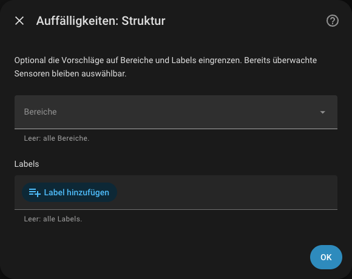
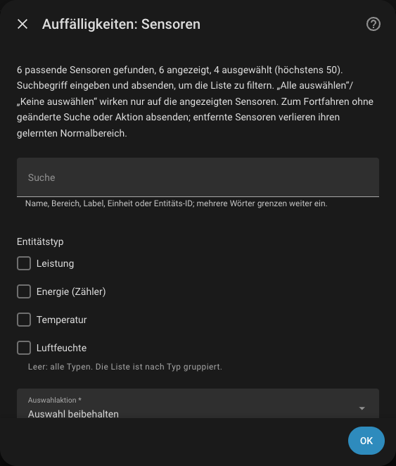
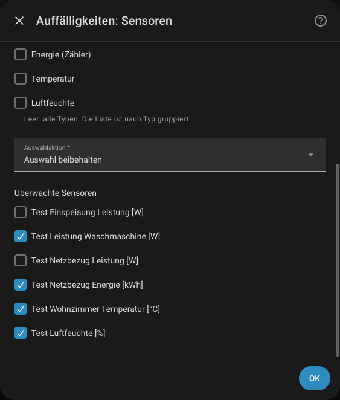
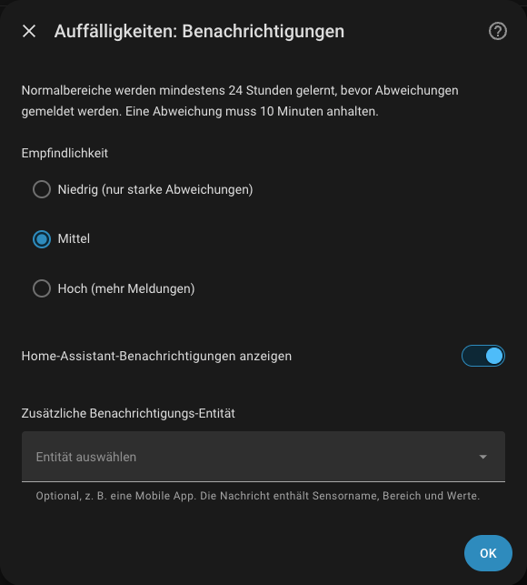
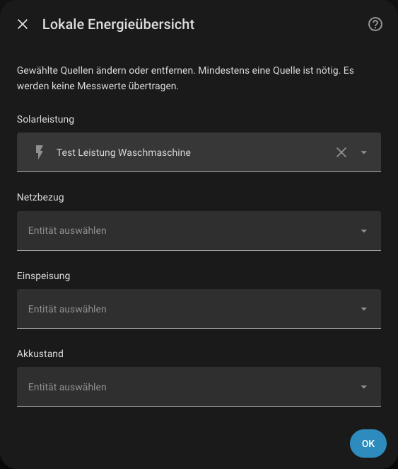
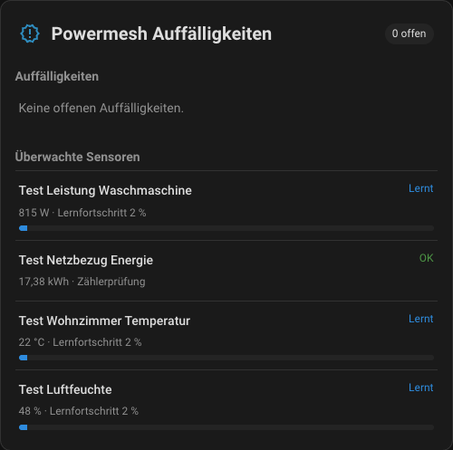
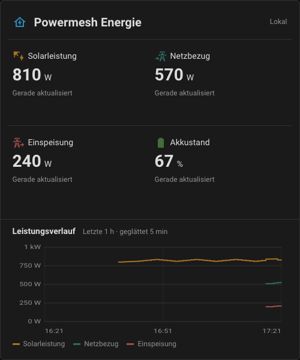

# Powermesh Energie – Home Assistant Integration (Prototyp)

Lokale Erkennung von Auffälligkeiten für Home Assistant: Powermesh schlägt
anhand deiner Bereiche, Labels und Geräte passende Sensoren vor, lernt deren
Normalbereich und meldet ungewöhnliches Verhalten oder Datenprobleme – direkt
in Home Assistant, ohne Konto und ohne Datenübertragung.

> **Status: Prototyp.** Die Integration befindet sich in Entwicklung und kann
> sich noch ändern. Sie ist nicht offiziell Teil von Home Assistant und wird
> nicht vom Home-Assistant-Projekt geprüft.

## Funktionen

- **Sensorvorschläge aus deiner Struktur:** Passende Sensoren werden anhand von
  Bereichen, Labels und Geräten vorgeschlagen. Überwacht wird nur, was du
  bestätigst (höchstens 50 Sensoren).
- **Gelernter Normalbereich:** Leistung (W/kW/MW), Temperatur und Luftfeuchte
  erhalten nach mindestens 24 Stunden Lernzeit einen Normalbereich. Hält eine
  Abweichung 10 Minuten an, entsteht eine Meldung; kurze Spitzen werden ignoriert.
- **Zählerprüfung:** Energiezähler (`total_increasing`) werden auf kurzzeitige
  Rücksprünge (typische Ursache für Spitzen in der Energiestatistik) und auf
  dauerhaft gesunkene Zählerstände geprüft. Ein Rücksetzen auf (nahezu) null gilt
  als normaler Zählerneustart.
- **Datenausfall:** Liefert ein Sensor 30 Minuten keine gültigen Werte, wird
  das gemeldet.
- **Benachrichtigung und Bestätigung:** Meldungen erscheinen als
  Home-Assistant-Benachrichtigung und optional über eine
  Benachrichtigungs-Entität (z. B. Mobile App), höchstens alle 6 Stunden je
  Sensor und Art. Bestätigte Abweichungen lassen den Normalbereich weiterlernen.
- **Entitäten für Automationen:** Sensor **Offene Auffälligkeiten** und
  Binärsensor **Auffälligkeit** (Problem).
- **Dashboard-Karten:** „Powermesh Auffälligkeiten“ mit offenen Meldungen,
  Normalbereichen und Lernfortschritt sowie die lokale **Energieübersicht**
  (Solarleistung, Netzbezug, Einspeisung, Akkustand).

Die Erkennung ist eine Plausibilitätsprüfung und keine Diagnose. Sie verspricht
keine Einsparungen und steuert keine Geräte.

## Deine Daten

Die Integration überträgt keine Daten an powermesh.de oder andere Dienste und
verwendet keine KI-Funktionen.

- **Auffälligkeiten:** Gespeichert werden je bestätigtem Sensor nur ein kompakter
  Lernstand (gleitender Mittelwert, typische Abweichung, letzte Werte) und bis zu
  20 beendete Meldungen in der geschützten `.storage`-Ablage von Home Assistant.
  Beim Entfernen des Eintrags wird dieser Lernstand gelöscht. Diagnosedaten
  enthalten nur Anzahlen, keine Werte oder Sensornamen.
- **Benachrichtigungen** enthalten Sensorname, Bereich und Werte. Wählst du eine
  Benachrichtigungs-Entität, gelten deren Zustellweg und Bedingungen.
- **Energieübersicht:** Gespeichert werden nur die ausgewählten
  Sensorreferenzen; die Karte liest aktuelle HA-Zustände.

Die vorhandene HA-Recorder-Aufbewahrung und Zugriffsrechte bleiben unverändert.
Hast du mit einer älteren Version eine Verbindung zu powermesh.de eingerichtet,
bleibt dieser Eintrag mit API-Schlüssel und lokal gepufferten Werten erhalten,
sendet aber nichts; eine Reparaturmeldung weist darauf hin. Entferne den Eintrag,
wenn du ihn nicht mehr brauchst.

## Installation über den Marketplace

Seit Home Assistant 2026.11 ist der Community-Store als **Marketplace** in
Home Assistant enthalten (bisher HACS). Er verwendet denselben Katalog.

[](https://my.home-assistant.io/redirect/hacs_repository/?owner=maxhro&repository=powermesh-energy-homeassistant&category=integration)

Der Button öffnet das Repository im Marketplace (bzw. in HACS). Alternativ von Hand:

1. **Einstellungen → Marketplace** öffnen (Administratorrechte erforderlich).
2. **Aus Link hinzufügen** wählen und
   `https://github.com/maxhro/powermesh-energy-homeassistant` als Typ
   **Integration** eintragen (dafür muss der Marketplace mit GitHub verbunden sein).
3. „Powermesh Energie“ herunterladen und Home Assistant neu starten.
4. **Einstellungen → Geräte & Dienste → Integration hinzufügen → Powermesh Energie**

Home Assistant bis 2026.10: HACS öffnen → Menü (⋮) → **Benutzerdefinierte
Repositories** → Repository wie oben als **Integration** hinzufügen, dann
Schritte 3 und 4.

Voraussetzung: Home Assistant 2026.10.4 (getesteter Stand) oder neuer und Sensoren
mit passender Geräteklasse und Einheit. Ein Konto oder API-Schlüssel ist nicht
nötig. Das Integrations-Icon zeigt Home Assistant ab Version 2026.3 an.

## Einrichtung

Beim Hinzufügen der Integration wählst du **Auffälligkeiten lokal erkennen**
oder **Lokal ohne Konto nutzen** (Energieübersicht). Andere
Home-Assistant-Integrationen werden davon nicht geändert.

### Auffälligkeiten lokal erkennen

1. Optional Bereiche und Labels wählen, um die Vorschläge einzugrenzen.
2. Die vorgeschlagenen Sensoren prüfen und bestätigen (höchstens 50).
   Vorgeschlagen werden Leistung, Temperatur, Luftfeuchte (Messwerte) und
   Energiezähler; deaktivierte Entitäten werden übergangen. Die Liste ist nach
   Entitätstyp gruppiert und lässt sich nach Typ und per Suchbegriff filtern.
   „Alle auswählen“ und „Keine auswählen“ wirken nur auf die angezeigten Sensoren.
3. Empfindlichkeit (niedrig, mittel, hoch) und Benachrichtigungen wählen.

Die folgenden Abbildungen zeigen die Konfiguration mit synthetischen Testdaten;
der Einrichtungsdialog verwendet dieselben Schritte.









Auswahl und Einstellungen lassen sich unter **Konfigurieren** ändern. Bei
geänderter Einheit beginnt das Lernen für diesen Sensor neu; entfernte Sensoren
verlieren ihren Lernstand.

Die Aktion `powermesh_energy.acknowledge` bestätigt eine Meldung (Befund-ID aus
den Attributen des Sensors **Offene Auffälligkeiten**) oder ohne ID alle offenen
Meldungen. Der Binärsensor **Auffälligkeit** ist eingeschaltet, solange eine
Meldung unbestätigt ist, und eignet sich als Auslöser eigener Automationen.

### Lokale Energieübersicht

1. **Lokal ohne Konto nutzen** wählen.
2. Mindestens eine Quelle auswählen: Solarleistung, Netzbezug oder Einspeisung
   in W/kW, optional Akkustand in Prozent. Die Auswahl ist nach Einheiten
   gefiltert. Netzbezug und Einspeisung brauchen getrennte einseitige Quellen;
   ein vorzeichenbehafteter gemeinsamer Netzsensor wird nicht automatisch geteilt.
3. Pro Bereich einen oder mehrere Sensoren wählen und speichern. Solarleistung,
   Netzbezug, Einspeisung, Akkustand und Leistungsverbraucher lassen sich unter
   **Konfigurieren** ändern oder entfernen.



### Dashboard-Karten

Beide Karten liegen in derselben Datei, die die Integration lokal in HA
bereitstellt und automatisch im Frontend lädt. Nach der Einrichtung das
Dashboard neu laden und **Bearbeiten → Karte hinzufügen** wählen; ein manueller
Eintrag unter **Einstellungen → Dashboards → Ressourcen** ist nicht nötig.
Wurde die Ressource `/powermesh-energy/powermesh-energy-card.js` früher von
Hand hinzugefügt, kann sie dort entfernt werden.

**Powermesh Auffälligkeiten** zeigt offene Meldungen mit
**Bestätigen**-Schaltfläche, je Sensor Status, aktuellen Wert, Normalbereich als
Balken und Lernfortschritt sowie zuletzt beendete Meldungen:



```yaml
type: custom:powermesh-anomaly-card
entity: sensor.powermesh_auffalligkeiten_offene_auffalligkeiten
```

Optional im Karteneditor zuschaltbar (standardmäßig aus):

| Option | Wirkung |
|---|---|
| `show_learning_bar` | Lernfortschritt als Balken |
| `show_history`, `history_hours` (1–48, Standard 6) | Verlaufsdiagramm je Sensor mit eingezeichnetem Normalbereich; liest nur die vorhandene HA-Historie |
| `show_timeline`, `timeline_days` (1–30, Standard 7) | Zeitleiste offener und beendeter Auffälligkeiten, getrennt nach Verhalten und Datenqualität |

**Powermesh Energie** zeigt die Quellen der lokalen Energieübersicht. Die
Leistungs-Kacheln sind einheitlich ausgerichtet. Fehlende Quellen, ungeeignete
Einheiten, negative einseitige Leistung und ungültiger Akkustand werden bei
konfigurierten Quellen ausdrücklich angezeigt; nicht zugeordnete Quellen werden
ausgeblendet. Mehrere Sensoren je Bereich erscheinen einzeln mit ihrem Namen.
Nach standardmäßig 15 Minuten ohne Aktualisierung wird
der letzte Wert als **Veraltet** markiert (im Karteneditor änderbar).



Optional im Karteneditor zuschaltbar (standardmäßig aus):

| Option | Wirkung |
|---|---|
| `sum_by_area` | Leistungsquellen eines Bereichs als Summe anzeigen; bei unvollständigen Quellen wird keine Teilsumme ausgegeben. |
| `average_battery_soc` | Mehrere Akkustände als Mittelwert anzeigen; bei unvollständigen Quellen wird kein Teilmittelwert ausgegeben. |
| `show_history` | Leistungsverlauf für ausgewählte Solar-, Netzbezugs- und Einspeisesensoren mit Raster, Zeitachse und Legende. Liest die vorhandene HA-Historie; der Akkustand wird nicht mit Leistung vermischt. |
| `history_hours` (1–48, Standard 6) | Zeitraum des Diagramms |
| `smoothing_minutes` (0–60, Standard 0) | Zeitgewichtete Glättung nur für die Diagrammanzeige; `0` zeigt die Rohkurve. Sensorwerte, Recorder und Anomalieerkennung bleiben unverändert. |

Keine Verbrauchsbilanz, Tagesaggregation, Sparprognose oder Steuerung.

```yaml
type: custom:powermesh-energy-card
entity: sensor.powermesh_energie_energieubersicht
show_history: true
history_hours: 6
smoothing_minutes: 5
```

Jeweils den tatsächlichen Entitätsnamen aus HA verwenden. Anklicken eines
Sensors öffnet die HA-Sensoransicht. Native Handy-Widgets sind nicht enthalten.

## Updates

Updates erscheinen unter **Einstellungen → System → Updates** bzw. unter
**Einstellungen → Marketplace** (bis Home Assistant 2026.10: HACS). Die neue
Version installieren und Home Assistant danach neu starten.

## Versionen

Diese Integration ist ein Prototyp in Version **0.9.2**. Sie wird unabhängig von
der Website powermesh.de versioniert und benötigt keinen Dienst.

## Lokale Tests

### Installationspaket (macOS und Windows)

Mit **PowerShell 7** lässt sich ohne Verbindung zu Home Assistant ein Paket bauen:

```powershell
pwsh -NoProfile -File ./build-package.ps1 -DryRun
pwsh -NoProfile -File ./build-package.ps1 -BuildPackage
```

Das Archiv `dist/powermesh-energy-homeassistant-0.9.2.zip` enthält
`custom_components/powermesh_energy` und die Lizenz, keine Testumgebung, Caches
oder Zugangsdaten. Vorhandene Archive werden nicht überschrieben.
Den enthaltenen Komponentenordner in das Konfigurationsverzeichnis von
Home Assistant entpacken und Home Assistant neu starten. Die Skripte installieren
nichts automatisch und veröffentlichen kein Release im Marketplace.

Die PowerShell-Paketprüfung läuft mit `node --test tests/package.test.mjs`
(Node wird nur für diese lokale Paketprüfung benötigt).

Mit einer separaten Python-Testumgebung: `pip install -r requirements_test.txt`,
danach `pytest -q` und `python -m compileall -q custom_components`.
Tests verwenden synthetische Daten und ersetzen den Netzwerktransport; sie kontaktieren
keine Produktivsysteme.

## Lizenz

Der Quellcode dieser Integration steht unter der [MIT-Lizenz](LICENSE).
Die Schnittstelle und die Dienste von powermesh.de sind nicht Gegenstand dieser
Lizenz; es werden daran keine Rechte eingeräumt. Ihre Nutzung richtet sich nach
den [Nutzungsbedingungen von powermesh.de](https://powermesh.de/?r=terms) und setzt
einen persönlichen Zugang voraus.

## Ausblick

Nicht Teil dieser Version, ohne Zusage oder Termin:

- **Freiwillige Übertragung an powermesh.de:** Die Integration soll ausgewählte
  Messwerte später optional an powermesh.de übertragen können. Die dafür
  vorhandene Verbindung ist im Quellcode erhalten, in dieser Version aber
  deaktiviert und wird bei der Einrichtung nicht angeboten. Für eine Übertragung
  würden ein Konto, eine ausdrückliche Einwilligung und die
  [Nutzungsbedingungen von powermesh.de](https://powermesh.de/?r=terms) gelten.
- **Vergleich zwischen Smart Homes:** Aus übertragenen Werten könnten sich später
  geeignete Systeme miteinander vergleichen lassen. Welche Vergleiche sinnvoll
  sind, ist offen; ein Vergleich ist nicht implementiert.

---

**English:** Prototype Home Assistant integration for local anomaly detection.
It suggests sensors from your areas, labels and devices, learns a normal range
for confirmed power, temperature and humidity sensors, checks energy meters for
glitches and decreases, detects missing data and reports findings via Home
Assistant notifications, an optional notify entity, a findings sensor, a problem
binary sensor and a dashboard card. No account, no data transfer and no AI are
used. Install it via Settings → Marketplace (Home Assistant 2026.11+) or HACS
(2026.10 and older). Code: MIT. Outlook, not part of this version: an optional
transfer of selected readings to powermesh.de and a comparison between smart
homes; the existing transfer code is disabled.
